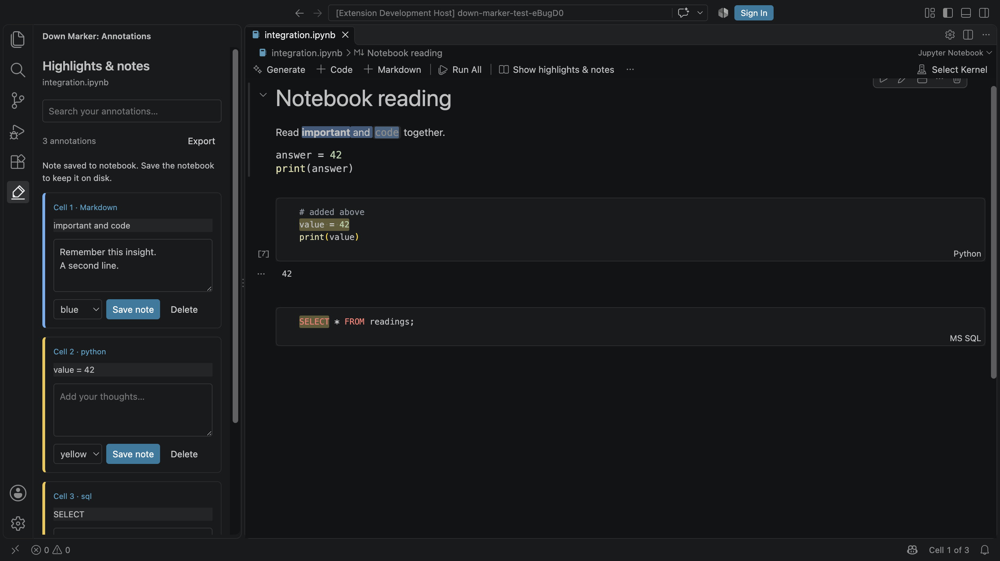

# Down Marker

Kindle-style highlights and notes, inside VS Code's Jupyter notebook editor.

Select a passage, give it a colour, and save your thoughts beside it. Annotate Python, SQL, R, Julia, or any other code-cell language. Highlight **rendered Markdown directly**, including bold text, links, inline code and fenced code blocks—without switching to Markdown source.



## Install

Build the extension using Node.js 22 or later:

```sh
npm ci
npm run build
npm run package
code --install-extension down-marker-0.1.0.vsix
```

Alternatively, in VS Code choose **Extensions → ⋯ → Install from VSIX…** and select the generated file. Reload VS Code if a notebook was already open. Requires VS Code 1.100 or later and its built-in Markdown support. A Jupyter kernel is only needed to execute cells, not to annotate them.

## Read and annotate

### Code and Markdown source

1. Select text inside a notebook cell.
2. Right-click and choose **Down Marker: Highlight selection** or **Add note to selection**.
3. Choose **Highlight selection with colour…** to pick yellow, green, blue or pink.

Keyboard shortcuts:

| Action | macOS | Windows / Linux |
| --- | --- | --- |
| Highlight selection | `⌘⌥H` | `Ctrl+Alt+H` |
| Add note to selection | `⌘⌥N` | `Ctrl+Alt+N` |

The default colour is configurable with `downMarker.defaultColor`. Remove a highlight using the context menu, with the caret inside it or a selection over it.

### Rendered Markdown

1. Select text in a rendered Markdown cell.
2. A compact toolbar appears below that cell. Choose a colour or **Add note**.
3. Click an existing highlight to change its colour, edit its note, or remove it.

Selections can span bold/italic text and inline code. Fenced code blocks retain their normal syntax colours beneath the highlights. Existing Markdown rendering, attachments and math plugins remain active. Each selection belongs to a single cell.

### Review your notes

Open **Down Marker** in the Activity Bar, use the notebook toolbar's book button, or run **Down Marker: Show highlights & notes**.

- Search both highlighted passages and your notes.
- Edit multiline notes and choose **Save note** (`⌘/Ctrl+Enter`).
- Click a cell label to jump back to the original passage.
- Delete an annotation or change its colour.
- Export all annotations in the current notebook as Markdown.

**Save the notebook** after changing annotations. “Save note” updates the notebook document; normal VS Code Save / Auto Save writes it to disk. Annotation changes participate in VS Code's notebook undo history.

## Portable storage

Annotations live in each `.ipynb` cell's standard `metadata.downMarker` namespace. No account, cloud service, sidecar file or external database is needed. Code, Markdown source, outputs and unrelated metadata are preserved when adding notes. Other notebook tools can open the notebook normally; they need Down Marker to display the highlights.

The stored schema is versioned. Each annotation contains an ID, colour, note, timestamp and a quote with surrounding context. This lets highlights relocate when unchanged text moves. If a highlighted passage is deleted or becomes ambiguous, the annotation is retained in the sidebar rather than attached to an arbitrary matching passage.

## Current boundaries

- Highlights apply to **cell source and rendered Markdown**, not arbitrary execution outputs, plots, images or text inside embedded widgets.
- A Markdown highlight can appear in both views when its quote is represented literally in the source. A selection crossing Markdown syntax (for example, `bold **words** and code`) is anchored to the view where it was created; the note is always available in the sidebar.
- Identical Markdown cells without unique Jupyter cell IDs may require choosing the correct cell on first annotation. Down Marker will not silently attach the note to another identical cell.
- Rich math is rendered by other plugins; only its selectable textual DOM content can be highlighted.
- Annotation edits require a writable notebook. Rendering saved annotations works in Restricted Mode.
- The Markdown adapter extends the built-in notebook renderer and attaches controls to its preview DOM. Changes to that renderer in future VS Code releases may require an update. Alternative replacement Markdown renderers are not currently supported.

## Development and checks

```sh
npm ci
npm run typecheck
npm test
npx playwright install chromium
npm run test:browser
npm run build
npm run test:host
npm run package
```

Press **F5** to open a development VS Code window with `examples/reading-notebook.ipynb`.

`test:host` launches an isolated VS Code profile. It verifies Python and SQL highlights, text relocation, preservation of outputs/metadata, persistence after reopening, and actual rendered-Markdown selection followed by sidebar note editing and saving. Set `VSCODE_EXECUTABLE_PATH` to an installed VS Code executable to use it instead of downloading stable VS Code. Browser tests cover formatted selections, overlapping highlights and asynchronous fenced-code tokenisation.

## Architecture

- `src/extension.ts` — commands, notebook metadata edits, editor decorations, annotation sidebar and renderer messaging.
- `src/renderer.ts` — extends `vscode.markdown-it-renderer`, adds selection controls and listens for note updates.
- `src/dom.ts` — DOM text anchoring and marks that preserve formatting and overlapping annotations.
- `src/model.ts` — portable schema, validation and conservative quote/context matching.
- `src/sidebar.ts` — searchable annotation list, note editor, colours and navigation.

MIT licensed.
